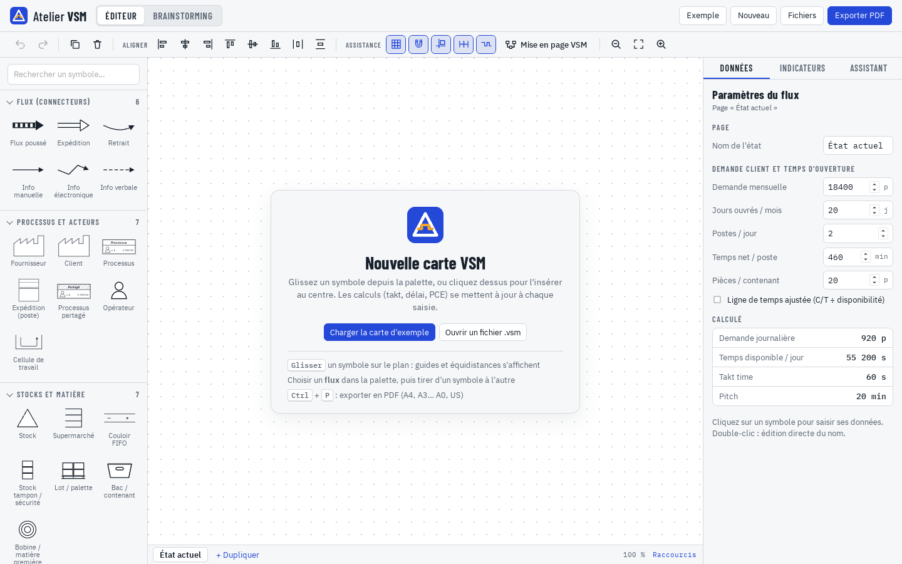
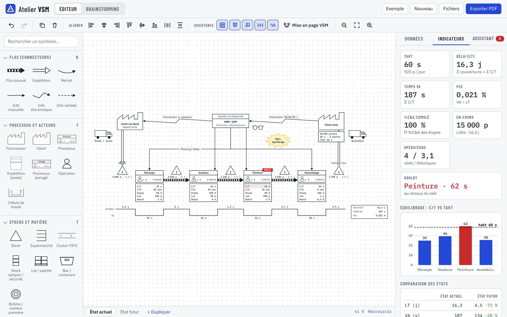
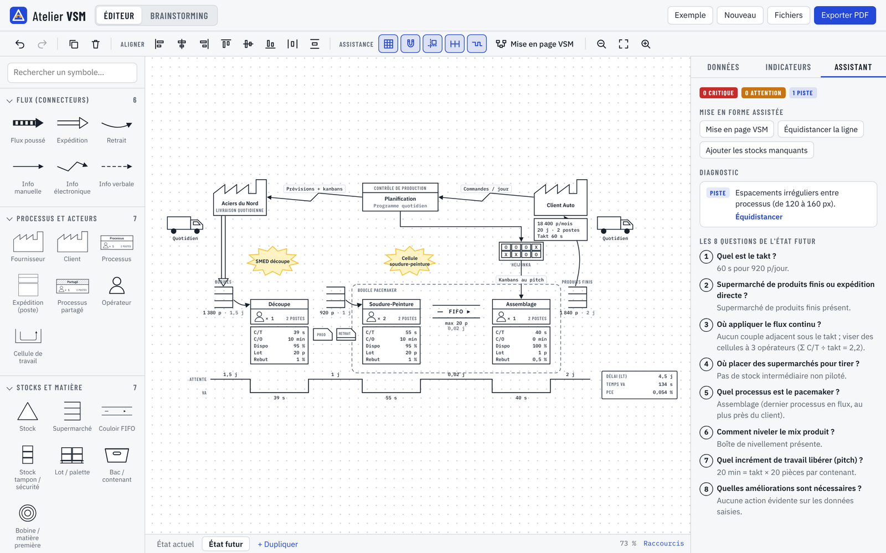
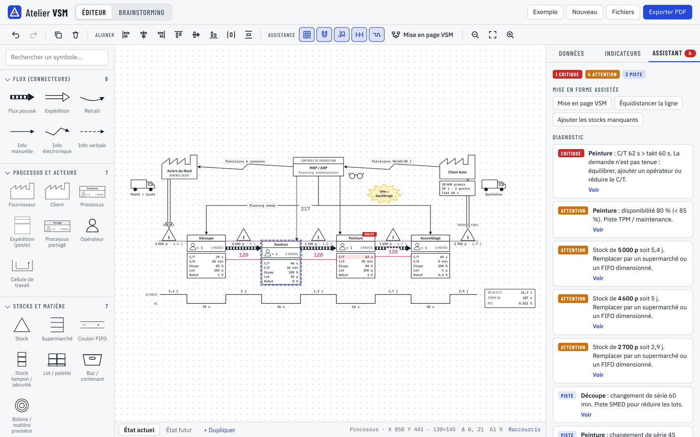
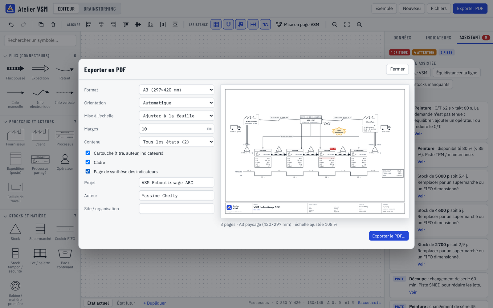
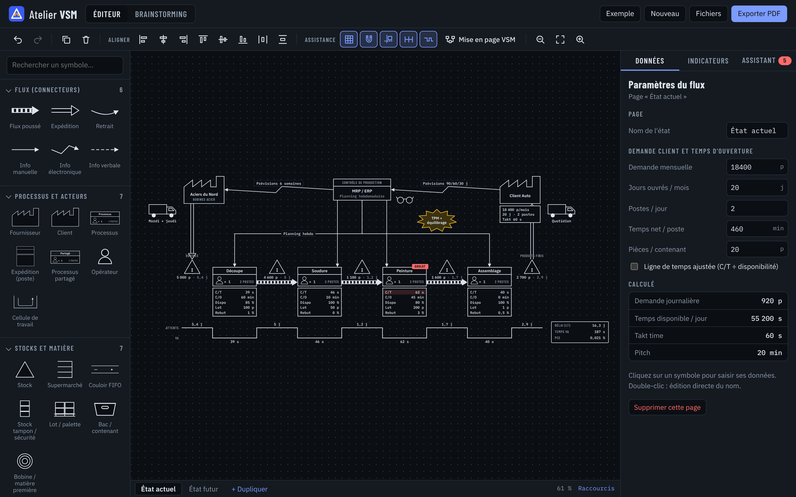
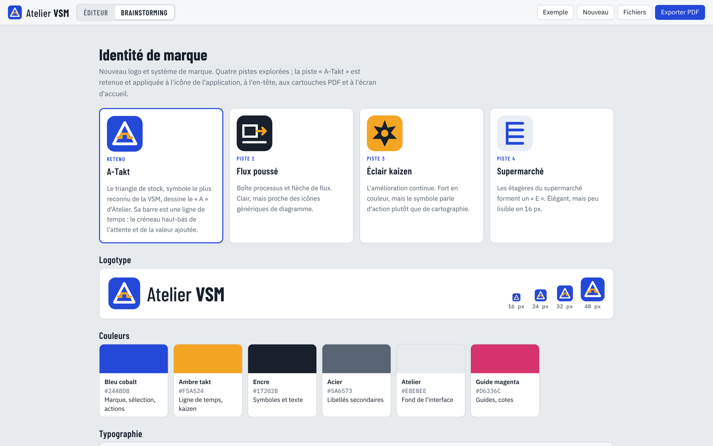
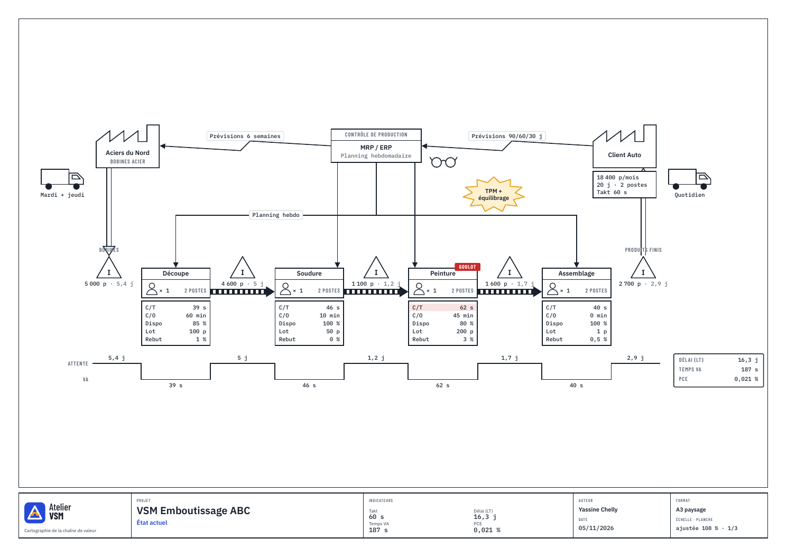
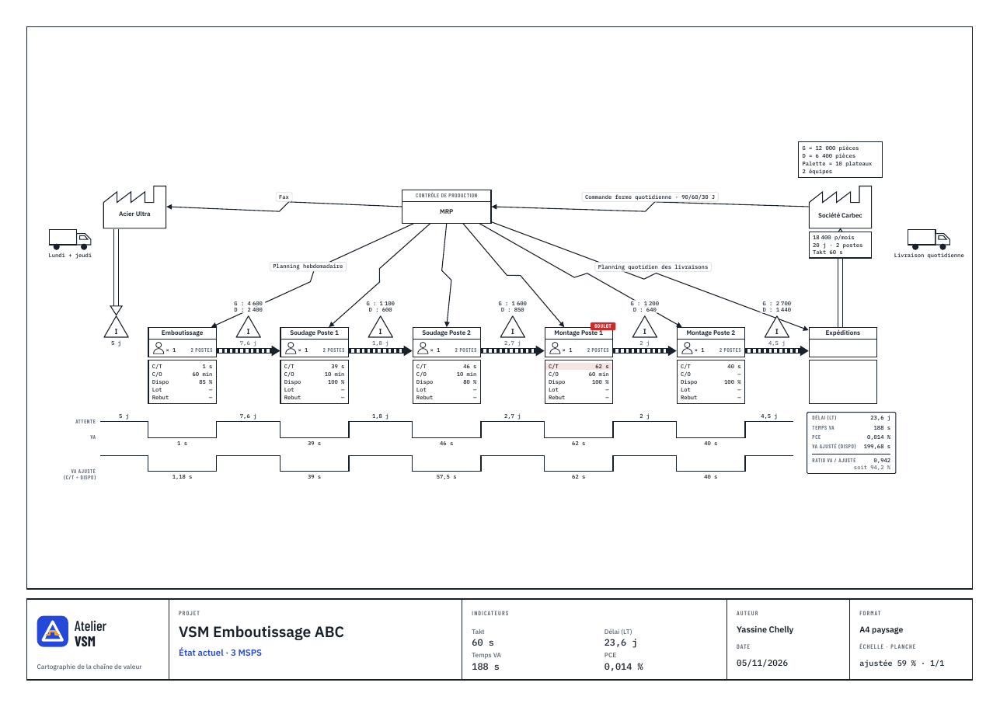

<p align="center"></p>

<h1 align="center">Atelier VSM</h1>

<p align="center">Application desktop (Rust + Tauri 2) de <b>cartographie de la chaîne de valeur (VSM)</b> :<br>on dessine la carte, l'application mesure, calcule et exporte en PDF.</p>


<p align="center"><i>Capture de l'application desktop réelle (Linux, WebKitGTK) au premier lancement : une carte vierge.</i></p>

## Aperçu

| Carte et indicateurs | État futur et assistant |
|---|---|
|  |  |
| **Guides et équidistances en direct** | **Export PDF : A5 à A0, US, ANSI, Arch** |
|  |  |
| **Thème sombre** | **Identité de marque** |
|  |  |

**Exemple de PDF exporté** (A3 paysage, cartouche, 3 pages : état actuel, état futur, synthèse) : [docs/exemple-export-A3.pdf](docs/exemple-export-A3.pdf)



### Exemple réel : VSM Emboutissage ABC

Carte relevée à la main puis saisie dans l'application et exportée en PDF A4 (stocks par référence G / D, ligne de temps ajustée à la disponibilité, ratio VA / VA ajusté) : [PDF](docs/exemples/VSM-Emboutissage-ABC.pdf) · [fichier .vsm à ouvrir dans l'application](docs/exemples/VSM-Emboutissage-ABC.vsm)



## Fonctionnalités

- **84 symboles VSM en SVG faits main, 10 familles**, plus 6 types de flux :
  - symboles officiels de *Learning to See* (Rother & Shook) et de *Seeing the Whole* ;
  - extensions sectorielles : transport et logistique (rail, aérien, maritime, express, cross-dock, entrepôt, milk run), bureau et services, santé et hôpital, logiciel et DevOps (%C&A), environnement (VSM durable : énergie, eau, déchets, CO2).
- **Ergonomie inspirée de draw.io** : palette repliable avec recherche, glisser-déposer, sélection au rectangle, zoom et panoramique, pages (état actuel / futur), annuler/rétablir, copier/coller.
- **Assistance au dessin** : guides d'alignement, détection et reproduction des équidistances avec cotes, magnétisme sur la grille, aligner/répartir, mise en page VSM automatique.
- **Calculs Lean en direct** :
  - takt, couverture des stocks, ligne de temps automatique ;
  - ligne de temps ajustée (C/T ÷ disponibilité) avec ratio ;
  - lead time, temps VA, PCE, en-cours (loi de Little), %C&A cumulé ;
  - opérateurs théoriques, capacité et charge par poste, goulot ;
  - équilibrage C/T vs takt, comparaison des états.
- **Assistant** : diagnostics (TPM, SMED, stocks, alignement, chevauchements) et les 8 questions de l'état futur.
- **Export PDF vectoriel** (moteur Rust `svg2pdf`, polices embarquées) :
  - formats A5 à 2A0, B1 à B4, Letter, Legal, Tabloid, ANSI C/D/E, Arch D/E ou format personnalisé ;
  - orientation automatique, marges ;
  - ajustement à la feuille, ou échelle fixe avec mosaïque automatique et repères d'assemblage ;
  - cartouche (projet, auteur, indicateurs, format, échelle) et page de synthèse.
- **Fichiers** : `.vsm` (Ctrl+O / Ctrl+S), export SVG, rapport CSV calculé par le moteur Rust.
- Onglet **Brainstorming** : dossier de conception (génie industriel, modélisation, formules, architecture, identité de marque, feuille de route).

## Télécharger

Les installateurs sont publiés dans les [Releases](../../releases) et sur la branche [`downloads`](../../tree/downloads) :

| Système | Fichier |
|---|---|
| Windows 10/11 (64 bits) | `atelier-vsm_0.2.0_windows_x64.zip` : dézipper puis lancer `Atelier VSM.exe` |
| Ubuntu / Debian | `atelier-vsm_0.2.0_amd64.deb` |
| Fedora / RHEL | `atelier-vsm-0.2.0-1.x86_64.rpm` |

## Structure

```
src/                    Interface (HTML/SVG/JS, polices embarquées, fonctionne hors ligne)
src-tauri/src/lib.rs    Commandes natives (fichiers, PDF, rapport, métriques)
src-tauri/src/pdf.rs    Export PDF multipage (svg2pdf + pdf-writer, polices embarquées)
src-tauri/src/vsm.rs    Moteur de calcul VSM + tests unitaires
src-tauri/examples/     svg_to_pdf : conversion de planches SVG en PDF en ligne de commande
docs/                   Captures d'écran et exemple de PDF exporté
```

## Développer

Prérequis : Rust stable, Node 20+ et, sous Linux, les paquets
`libwebkit2gtk-4.1-dev libgtk-3-dev libayatana-appindicator3-dev librsvg2-dev libxdo-dev`.

```bash
npm install
npm run dev        # lance l'application
npm run build      # produit les installateurs dans src-tauri/target/release/bundle
cargo test --manifest-path src-tauri/Cargo.toml
```

## Publier une version

Mettre à jour `version` dans `src-tauri/tauri.conf.json`, `src-tauri/Cargo.toml` et `package.json`, puis :

```bash
git push origin main:release
```

Le workflow `Release` construit les installateurs Windows (`.msi`, `.exe`), macOS (`.dmg`) et Linux (`.AppImage`, `.deb`, `.rpm`) et les publie dans une release GitHub. GitHub Actions doit être actif sur le compte.

## Licence

MIT. Polices IBM Plex et Barlow Condensed : SIL Open Font License 1.1.
